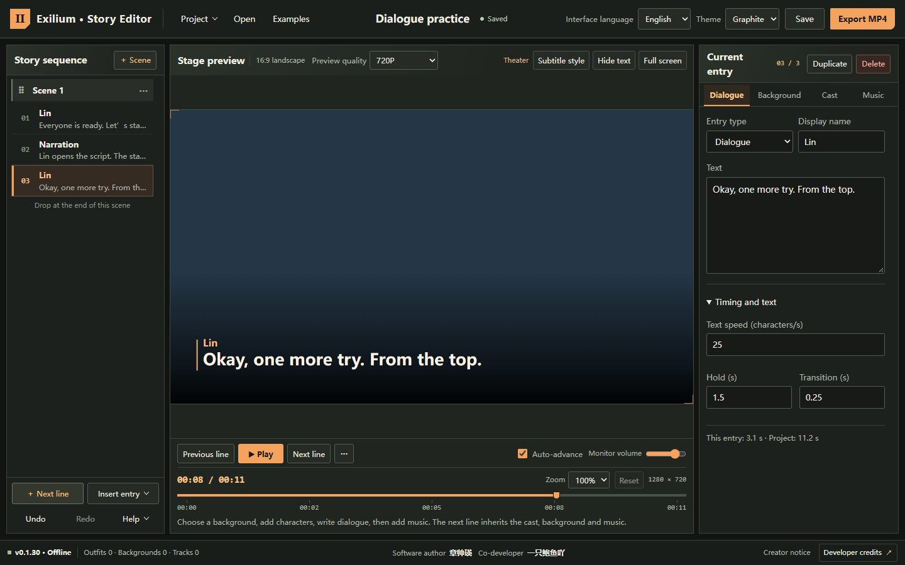

# Girls' Frontline Story Editor

[简体中文](README.md) · [繁體中文](README.zh-TW.md) · English · [日本語](README.ja.md)

An unofficial fan-story editor for Girls’ Frontline 2: Exilium. Arrange dialogue, narration, and pauses into scenes. Set character entrances, positions, and expressions using local models, then preview the result in a browser and export a widescreen MP4.

The project is independent of the game's operators and rights holders.

**0.1.40 · Windows x64 · Runs locally**

Light is the default theme. With local materials configured, the character picker uses verified default outfits as covers and keeps those covers when you search for other outfits.



*Screenshot of the Graphite theme with an empty media catalog and original sample dialogue.*

## What you can do

- **Interface languages.** Use the top bar to switch between Simplified Chinese, Traditional Chinese, English and Japanese. The editor uses system fonts.
- **Themes and stage navigation.** Choose Graphite or Light from the top bar. Set preview quality separately, scroll to zoom, hold the middle mouse button to pan, and select Reset to recenter the full frame.
- **Build a story.** Organize scenes and entries, and adjust text speed, hold times, and transitions.
- **Preview the staging.** Use local models, textures, backgrounds, and music. Scrub the timeline to check character placement, expressions, and audio timing.
- **Switch subtitle styles.** Choose the game-style layout or large theater subtitles for the whole project. The theater style has separate colors for the name, dialogue, and accent line. Preview and MP4 use the same selection.
- **Save and export.** Save projects locally and export 16:9 MP4. The configured Windows helper is preferred for H.264 + AAC. H.265 depends on the device. External FFmpeg is available as a fallback.

The repository is limited to the editor source, tests, configuration templates, documentation, an editor screenshot, and a separately licensed compatibility patch. You supply and configure your own models, images, audio, and any local example project. Game media is subject to its rights holders' terms. [Source and feature scope (Chinese)](docs/SOURCE_SCOPE.md) · [Media rights (Chinese)](ASSET_RIGHTS.md)

## Run locally

1. Prepare Node.js 24.x and Purism Core 1.1.0 for Windows x64 with the v6 ABI. For MP4 export, build the Windows helper or install FFmpeg with FLAC decoding, AAC encoding, and `libx264` or `libx265`. [Windows helper build](src/native/BUILD.md) · [Third-party dependencies](THIRD_PARTY_NOTICES.md)
2. Copy the [configuration template](local-config.example.json) outside the source directory as `editor.local.json`. Set your media directory, a separate workspace, the Purism Core DLL, and the encoder paths you prepared. Relative paths are resolved from the configuration file. [Local configuration](docs/LOCAL_ASSETS.md)
3. If your media catalog and checksum index are ready, run the startup commands below. To open a blank project, first create `assets/catalog.json` inside your materials directory with `{"version":"local","backgrounds":[],"characters":[],"music":[]}`. Then run `node scripts/index-materials.mjs 'C:/GFSE-local/materials'` from the source root. Replace the example paths with your own.

```powershell
npm.cmd ci --ignore-scripts
node src/server/start.mjs --config 'C:/GFSE-local/editor.local.json'
```

The terminal prints the local editor URL. Add `--no-browser` if you prefer to open it yourself. Open Dialogue practice from Examples. The built-in sample follows the interface language and can be used for the four-step quick start, including a three-second MP4 export. Set `exampleProject` to use a copy of your own example with its original dialogue.

## Verify the source

```powershell
node scripts/verify-manifest.mjs
node scripts/check.mjs
```

These commands verify the source inventory, check JavaScript syntax, and run the tests.

## License and credits

This project is provided free of charge as **source-available software under a noncommercial license**. The project's original source is licensed under **PolyForm Noncommercial 1.0.0**. See the license text for permitted uses. The OSI Open Source Definition requires allowing commercial use. [License](LICENSE.md) · [License scope (Chinese)](LICENSE_SCOPE.md) · [OSI Open Source Definition](https://opensource.org/osd)

The editor reads MOC3 models using Sakura Motion Project's **Purism Core 1.1.0**. The upstream library and the bundled compatibility patch are both licensed under **MIT**. The project has no affiliation with Live2D Inc. [Third-party dependencies (Chinese)](THIRD_PARTY_NOTICES.md) · [Purism Core build notes (Chinese)](docs/PURISM.md)

Created by 章帅瑛, with development contributions from 一只鲍鱼吖. [Credits](AUTHORS) · [Media rights (Chinese)](ASSET_RIGHTS.md)
