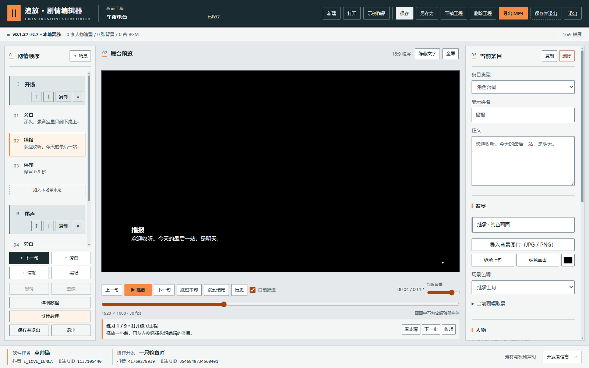

# Girls' Frontline Story Editor

[简体中文](README.md) · English

An unofficial fan-story editor for Girls’ Frontline 2: Exilium. Arrange dialogue, narration, and pauses into scenes. Set character entrances, positions, and expressions using local models, then preview the result in a browser and export a widescreen MP4.

The project is independent of the game's operators and rights holders.

**0.1.27-rc.7 · Windows x64 · Runs locally**



*Screenshot from a live session with an empty media catalog and original sample dialogue.*

## What you can do

- **Build a story.** Organize scenes and entries, and adjust text speed, hold times, and transitions.
- **Preview the staging.** Use local models, textures, backgrounds, and music. Scrub the timeline to check character placement, expressions, and audio timing.
- **Save and export.** Save projects locally and export a selected range as a 16:9 MP4 with H.264 or H.265 video.

The repository is limited to the editor source, tests, configuration templates, documentation, an editor screenshot, and a separately licensed compatibility patch. You supply and configure your own local models, images, audio, and practice projects. Game media is subject to its rights holders' terms. [Source and feature scope (Chinese)](docs/SOURCE_SCOPE.md) · [Media rights (Chinese)](ASSET_RIGHTS.md)

## Run locally

1. Install Node.js 24.x, the Windows x64 build of Purism Core 1.1.0 with the v6 ABI, and FFmpeg with FLAC decoding, AAC encoding, and either `libx264` or `libx265`. [Dependency and build notes (Chinese)](THIRD_PARTY_NOTICES.md)
2. Copy the [configuration template](local-config.example.json) outside the source directory as `editor.local.json`. Set `materialsDirectory`, a separate `workspaceDirectory`, the `purismCore` DLL path, and the `ffmpeg` executable path. Relative paths are resolved from the configuration file. [Media catalog format (Chinese)](docs/LOCAL_ASSETS.md)
3. If your media catalog and checksum index are ready, run the startup commands below. To open a blank project, first create `assets/catalog.json` inside your materials directory with `{"version":"local","backgrounds":[],"characters":[],"music":[]}`. Then run `node scripts/index-materials.mjs 'C:/GFSE-local/materials'` from the source root. Replace the example paths with your own.

```powershell
npm.cmd ci --ignore-scripts
node src/server/start.mjs --config 'C:/GFSE-local/editor.local.json'
```

The terminal prints the local editor URL. Add `--no-browser` if you prefer to open it yourself. Set the optional `exampleProject` path to open a local practice project in a new workspace.

## Verify the source

```powershell
node scripts/verify-manifest.mjs
node scripts/check.mjs
```

These commands verify the source inventory, check JavaScript syntax, and run the tests.

## License and credits

This project is provided free of charge as **source-available software under a noncommercial license**. The project's original source is licensed under **PolyForm Noncommercial 1.0.0**. See the license text for permitted uses. The OSI Open Source Definition requires allowing commercial use. [License](LICENSE.md) · [License scope (Chinese)](LICENSE_SCOPE.md) · [OSI Open Source Definition](https://opensource.org/osd)

The editor reads MOC3 models using Sakura Motion Project's **Purism Core 1.1.0**. The upstream library and the bundled compatibility patch are both licensed under **MIT**. The project has no affiliation with Live2D Inc. [Third-party dependencies (Chinese)](THIRD_PARTY_NOTICES.md) · [Purism Core build notes (Chinese)](docs/PURISM.md)

Created by 章帅瑛, with development contributions from 一只鲍鱼吖. [Credits](AUTHORS) · [Media rights (Chinese)](ASSET_RIGHTS.md)
