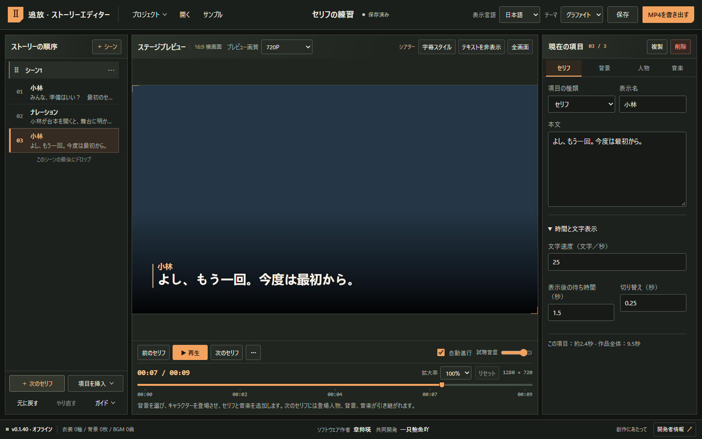

# Girls' Frontline Story Editor

[简体中文](README.md) · [繁體中文](README.zh-TW.md) · [English](README.en.md) · 日本語

『ドールズフロントライン2：エクシリウム』の二次創作向けストーリーエディターです。セリフ、ナレーション、間をシーンにまとめ、手元のキャラクターモデルの登場・退場、立ち位置、表情を設定できます。演出はブラウザーでプレビューし、横長の MP4 に書き出せます。

本プロジェクトはゲームの運営元や権利者から独立したファンプロジェクトです。本ツールでプレイヤーが制作した二次創作は、公式ストーリーとは無関係です。 [素材の権利と利用上の注意（中国語）](ASSET_RIGHTS.md)

**0.1.40 · Windows x64 · ローカル実行**

初期テーマはライトです。ローカル素材を設定すると、キャラクター一覧のサムネイルには確認済みの標準衣装が優先して使われます。別の衣装を検索しても、一覧のサムネイルは変わりません。

*画面例はダークテーマで、空の素材一覧と自作のセリフを使用しています。*

## 主な機能

- **表示言語とテーマ。** 簡体字中国語、繁体字中国語、英語、日本語に切り替えられます。表示にはシステムフォントを使用し、ダークテーマとライトテーマを選べます。
- **ストーリーと演出の編集。** セリフの順番、文字の表示速度、表示時間、場面転換を調整できます。ローカルのモデル、画像、背景、音楽を配置し、タイムラインで表情や音楽のつながりを確認できます。
- **ステージプレビュー。** プレビュー画質は書き出し設定とは別に選べます。マウスホイールで拡大・縮小し、中ボタンを押したままドラッグすると表示位置を移動できます。「リセット」でステージ全体を中央に表示します。
- **字幕スタイル。** ゲーム風の字幕と、大きな文字を使う「小劇場」スタイルを切り替えられます。「小劇場」では話者名、セリフ、左の縦線の色を設定できます。選んだスタイルはプレビューと書き出した動画の両方に反映されます。
- **保存と動画の書き出し。** プロジェクトをローカルに保存し、16:9 の MP4 に書き出せます。Windows 用の補助プログラムを設定すると H.264 と AAC を使用できます。H.265 の対応は端末に依存し、別途インストールした FFmpeg も使用できます。

このリポジトリにはエディターのソースコード、テスト、設定例、ドキュメント、画面例、ライセンスを明記した互換性パッチが含まれます。モデル、画像、音楽、練習用プロジェクトは、利用条件を確認したうえで手元のファイルを設定してください。 [ソースコードと機能の範囲（中国語）](docs/SOURCE_SCOPE.md)

## ローカルで起動する

1. Node.js 24.x と Windows x64 向けの **Purism Core 1.1.0**（v6 ABI）を用意します。MP4 を書き出す場合は、Windows 用の補助プログラムをビルドするか、FLAC、AAC、libx264 または libx265 に対応した FFmpeg を別途用意します。 [Windows 用補助プログラムのビルド（中国語）](src/native/BUILD.md) · [外部依存関係とライセンス（中国語）](THIRD_PARTY_NOTICES.md)
2. 設定例をソースコードのフォルダーの外にコピーし、名前を editor.local.json に変更します。素材フォルダー、作業フォルダー、Purism Core DLL、用意したエンコーダーのパスを指定します。相対パスは設定ファイルの場所を基準に解決されます。 [設定例](local-config.example.json) · [ローカル素材の設定（中国語）](docs/LOCAL_ASSETS.md)
3. 素材を使わずに試す場合は、素材フォルダーの assets/catalog.json に {"version":"local","backgrounds":[],"characters":[],"music":[]} を記入します。そのフォルダーを引数にして node scripts/index-materials.mjs を実行すると、素材の検証用リストを作成できます。

~~~powershell
npm.cmd ci --ignore-scripts
node src/server/start.mjs --config 'C:/GFSE-local/editor.local.json'
~~~

設定ファイルのパスは実際の保存場所に置き換えてください。ターミナルには起動メッセージとローカルの URL が中国語と英語の順に、分かれて表示されます。--no-browser を付けると、ブラウザーを自分で開けます。「サンプル作品」から、各表示言語に対応した「セリフの練習」を開けます。

## 検証とライセンス

~~~powershell
node scripts/verify-manifest.mjs
node scripts/check.mjs
~~~

最初のコマンドで配布ファイルの一覧と SHA-256 を検証します。次のコマンドで JavaScript の構文を確認し、テストを実行します。

プロジェクトが独自に作成したコードとドキュメントは **PolyForm Noncommercial 1.0.0** に基づき、ソースコードを公開しています。Purism Core と同梱の互換性パッチには **MIT ライセンス**が適用されます。本プロジェクトは Live2D Inc. から独立しています。 [ライセンス英語原文](LICENSE.md) · [日本語全文参考訳](docs/license-ja.md) · [適用範囲（中国語）](LICENSE_SCOPE.md) · [Purism Core のビルド（中国語）](docs/PURISM.md)

ソフトウェア作者は章帅瑛、共同開発は一只鲍鱼吖です。 [クレジット](AUTHORS)
