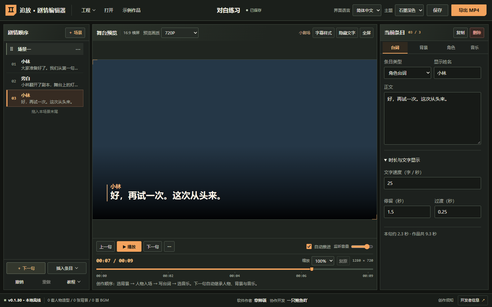

# Girls' Frontline Story Editor

简体中文 · [繁體中文](README.zh-TW.md) · [English](README.en.md) · [日本語](README.ja.md)

《少女前线2：追放》的非官方同人剧情编辑器。把对白、旁白和停顿编排成场景，为本地人物模型设置出入场、站位和表情，随后在浏览器预览并导出横屏 MP4。

本项目与游戏运营方及权利人无隶属关系。

**0.1.40 · Windows x64 · 本地运行**

默认主题为明亮浅色。配置本地素材后，人物列表会优先用已确认的原皮做封面，搜索其他造型时封面保持固定。



*截图采用石墨深色主题，使用空素材清单和自写对白。*

## 可以做什么

- **界面语言。** 通过顶部菜单切换简体中文、繁體中文、英文或日文。界面使用本机字型。
- **主题与舞台视图。** 顶栏可切换石墨深色和明亮浅色。舞台画质独立设置，滚轮缩放，按住鼠标中键平移，点击「复原」回到居中的完整画面。
- **编排剧情。** 将故事拆成多个场景，调整条目顺序、打字速度、停留和转场。
- **预览演出。** 用本地模型、贴图、背景和配乐编排舞台，拖动时间轴检查人物站位、表情和音乐衔接。
- **切换字幕。** 为整部作品选择游戏原版布局或小剧场大字字幕，自定义角色名、台词和竖线颜色。舞台与 MP4 使用同一模式。
- **保存和导出。** 保存本地工程并导出 16:9 MP4。已配置的 Windows 调用程序优先导出 H.264 + AAC，H.265 取决于设备，外置 FFmpeg 可作备用。

仓库收录范围限于编辑器源码、测试、配置模板、文档、编辑器实机截图和标明许可的兼容补丁。模型、图像、配乐和原作练习工程由使用者自行配置。游戏素材的使用依据相应权利人的许可。 [源码与功能范围](docs/SOURCE_SCOPE.md) · [素材权利](ASSET_RIGHTS.md)

## 在本机启动

1. 准备 Node.js 24.x 和 Windows x64 的 Purism Core 1.1.0 v6 版本。需要 MP4 导出时，可构建 Windows 调用程序，或准备支持 FLAC、AAC 和 `libx264` 或 `libx265` 的外置 FFmpeg。 [Windows 导出构建](src/native/BUILD.md) · [第三方依赖](THIRD_PARTY_NOTICES.md)
2. 将 [配置模板](local-config.example.json) 复制到源码目录之外，命名为 `editor.local.json`。填写素材目录、独立工作区、Purism Core DLL 和已准备的编码器路径。相对路径以配置文件所在位置为准。 [本地配置](docs/LOCAL_ASSETS.md)
3. 有素材目录和校验清单时，可直接执行下面的启动命令。只想打开空白工程时，先在素材目录中创建 `assets/catalog.json`，写入 `{"version":"local","backgrounds":[],"characters":[],"music":[]}`，再在源码目录运行 `node scripts/index-materials.mjs 'C:/GFSE-local/materials'`。按你的实际路径替换命令中的示例路径。

```powershell
npm.cmd ci --ignore-scripts
node src/server/start.mjs --config 'C:/GFSE-local/editor.local.json'
```

终端会分两段显示启动提示和本机编辑器地址，先中文后英文。启动时加 `--no-browser` 可手动打开该地址。从「示例作品」可打开四语「对白练习」。「快速上手」可从该练习开始，演示编辑、字幕样式与导出 3 秒 MP4。可用 `exampleProject` 指定本地示例，原对话按文件保留。

## 验证源码

```powershell
node scripts/verify-manifest.mjs
node scripts/check.mjs
```

这些命令检查发布清单、JavaScript 语法及独立测试。

## 许可与署名

本项目免费提供，采用**源码可见、非商业许可**。项目原创代码适用 **PolyForm Noncommercial 1.0.0**，具体许可范围以原文为准。OSI 的开源定义要求允许商业用途。 [适用范围](LICENSE_SCOPE.md) · [OSI 开源定义](https://opensource.org/osd)

[英文许可原文](LICENSE.md) · [简体中文全文译读](docs/license-zh-CN.md) · [繁體中文全文譯讀](docs/license-zh-TW.md) · [日本語全文参考訳](docs/license-ja.md)

本项目使用 Sakura Motion Project 的 **Purism Core 1.1.0** 读取 MOC3。上游与随附的兼容补丁均采用 **MIT**。本项目与 Live2D Inc. 无隶属关系。 [第三方依赖](THIRD_PARTY_NOTICES.md) · [Purism Core 构建说明](docs/PURISM.md)

软件作者为章帅瑛，协作开发为一只鲍鱼吖。 [作者署名](AUTHORS) · [素材权利](ASSET_RIGHTS.md)
