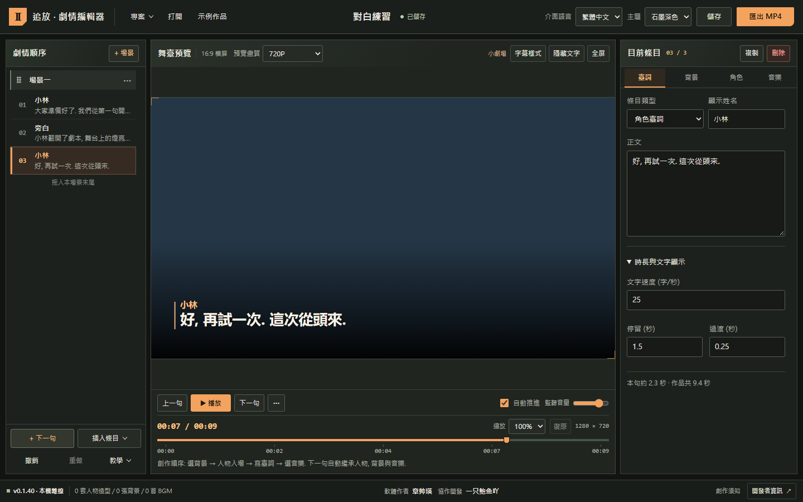

# Girls' Frontline Story Editor

[简体中文](README.md) · 繁體中文 · [English](README.en.md) · [日本語](README.ja.md)

《少女前線2：追放》的非官方同人劇情編輯器。把對白、旁白和停頓編排成場景，為本機人物模型設定登場、退場、站位與表情，再於瀏覽器預覽並匯出橫式 MP4。

本專案與遊戲營運方及權利人無隸屬關係。

**0.1.40 · Windows x64 · 在本機執行**

預設主題為明亮淺色. 設定本機素材後, 人物列表會優先使用已確認的原始造型作為封面, 搜尋其他造型時封面保持固定.



*截圖採用石墨深色主題, 使用空白素材清單與自寫對白.*

## 功能

- **介面語言。** 從上方選單切換簡體中文、繁體中文、英文或日文。編輯器使用本機字型。
- **主題與舞臺視圖。** 從頂欄切換石墨深色和明亮淺色。可獨立設定舞臺畫質，以滾輪縮放、按住滑鼠中鍵平移，或點「復原」回到置中的完整畫面。
- **編排劇情。** 將故事拆成多個場景，調整條目順序、文字顯示速度、停留時間與轉場。
- **預覽演出。** 使用本機模型、貼圖、背景與配樂編排舞台，拖曳時間軸檢查人物站位、表情及音樂銜接。
- **切換字幕。** 整部作品可選原版版面或小劇場大字字幕，並自訂角色名、台詞和側邊直線的顏色。舞台預覽與 MP4 使用同一種樣式。
- **儲存與匯出。** 可在本機儲存專案並匯出 16:9 MP4。已設定的 Windows 呼叫程式優先輸出 H.264 + AAC。H.265 取決於裝置，外部 FFmpeg 可作備用。

本儲存庫收錄編輯器原始碼、測試、設定範本、文件、編輯器實機截圖及標明授權的相容性修補檔。模型、圖像、配樂及原作練習專案由使用者自行準備與設定。遊戲素材請依各權利人的授權使用。 [原始碼與功能範圍](docs/SOURCE_SCOPE.md) · [素材權利](ASSET_RIGHTS.md)

## 在本機啟動

1. 準備 Node.js 24.x 和採用 v6 ABI 的 Windows x64 版 Purism Core 1.1.0。需要匯出 MP4 時，可建置 Windows 呼叫程式，或安裝支援 FLAC、AAC、`libx264` 或 `libx265` 的外部 FFmpeg。 [Windows 匯出程式建置](src/native/BUILD.md) · [第三方相依元件](THIRD_PARTY_NOTICES.md)
2. 將[設定範本](local-config.example.json)複製到原始碼目錄之外並命名為 `editor.local.json`。填入素材目錄、獨立工作區、Purism Core DLL 及已備妥的編碼器路徑。相對路徑以設定檔所在目錄為準。 [本機設定](docs/LOCAL_ASSETS.md)
3. 備妥素材目錄和雜湊清單後，即可執行下方指令。若想開啟空白專案，先在素材目錄內建立 `assets/catalog.json`，寫入 `{"version":"local","backgrounds":[],"characters":[],"music":[]}`，再到原始碼目錄執行 `node scripts/index-materials.mjs 'C:/GFSE-local/materials'`。請將範例路徑換成你的實際路徑。

```powershell
npm.cmd ci --ignore-scripts
node src/server/start.mjs --config 'C:/GFSE-local/editor.local.json'
```

終端機會顯示本機編輯器網址。啟動時加上 `--no-browser` 即可自行開啟網址。可從「示例作品」開啟四語「對白練習」。「快速上手」可從這份練習開始，示範編輯、字幕樣式及匯出 3 秒 MP4。可用 `exampleProject` 指定本機範例，原對白依檔案保留。

## 驗證原始碼

```powershell
node scripts/verify-manifest.mjs
node scripts/check.mjs
```

這些指令會核對原始碼清單、檢查 JavaScript 語法並執行測試。

## 授權與署名

本專案免費提供，**可取得原始碼，採非商業授權**。專案原創程式碼採用 **PolyForm Noncommercial 1.0.0**，詳見授權條款原文。OSI 的開放原始碼定義要求允許商業用途。 [授權條款](LICENSE.md) · [適用範圍](LICENSE_SCOPE.md) · [OSI 開放原始碼定義](https://opensource.org/osd)

編輯器使用 Sakura Motion Project 的 **Purism Core 1.1.0** 讀取 MOC3 模型。上游函式庫及隨附的相容性修補檔均採 **MIT** 授權。本專案與 Live2D Inc. 無隸屬關係。 [第三方相依元件](THIRD_PARTY_NOTICES.md) · [Purism Core 建置說明](docs/PURISM.md)

軟體作者為章帅瑛，協作開發為一只鲍鱼吖。 [章帅瑛的 YouTube @ShuaiYingZhang](https://www.youtube.com/@ShuaiYingZhang) · [作者署名](AUTHORS) · [素材權利](ASSET_RIGHTS.md)
